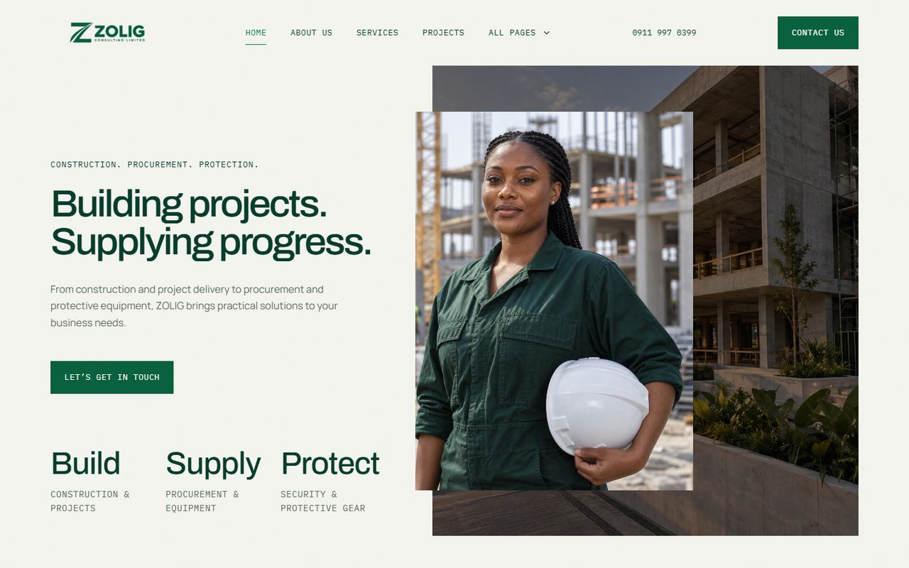

# ZOLIG Consulting website

Company website for ZOLIG Consulting Limited, a Nigerian company working across construction, procurement and protective equipment.

**Live:** [zolig-constructionltd.vercel.app](https://zolig-constructionltd.vercel.app)



## The problem

Three separate service lines needed to read as one credible company, while keeping the existing green identity. The site is organised around a simple story of Build, Supply and Protect.

## Features

- Service, project and journal pages generated from structured content, with detail pages for each
- About, team, how-we-work and gallery pages
- Enquiry form that sends mail through Resend, and falls back to showing the company's email and phone when mail isn't configured
- Responsive layouts, with custom loading, error and 404 pages

## Structure

| Path | Contents |
|---|---|
| `app/` | Routes, including `app/api/enquiry` for the form |
| `components/` | Header, page sections, enquiry form |
| `lib/content.ts`, `lib/content-seed.ts` | Site content |
| `lib/enquiry.ts` | Enquiry validation and sending |

## Stack

Next.js 16, React 19, TypeScript, Tailwind CSS, Resend

## Running locally

Requires Node.js 22.13 or later.

```sh
npm ci
cp .env.example .env.local
npm run dev
```

| Variable | Purpose |
|---|---|
| `RESEND_API_KEY` | Resend key for the enquiry form |
| `ENQUIRY_FROM` | Sender address on a domain verified in Resend |
| `CMS_ADMIN_EMAILS` | Allowed admin emails for the content manager |

`npm run build` creates a production build and `npm run lint` runs ESLint. The project has no automated tests yet.

## Deployment

Deployed on Vercel as a standard Next.js project. Details are in [VERCEL-DEPLOYMENT.md](./VERCEL-DEPLOYMENT.md).

## Known limitation

The site began as an export from a hosted site builder. The `/admin` content manager still depends on that platform's sign-in, Cloudflare D1 and R2, none of which exist on Vercel, so it isn't active in production. Content is edited in `lib/`.

## Next

- Replace the content manager's auth and storage so it works on Vercel
- Add tests around enquiry validation
